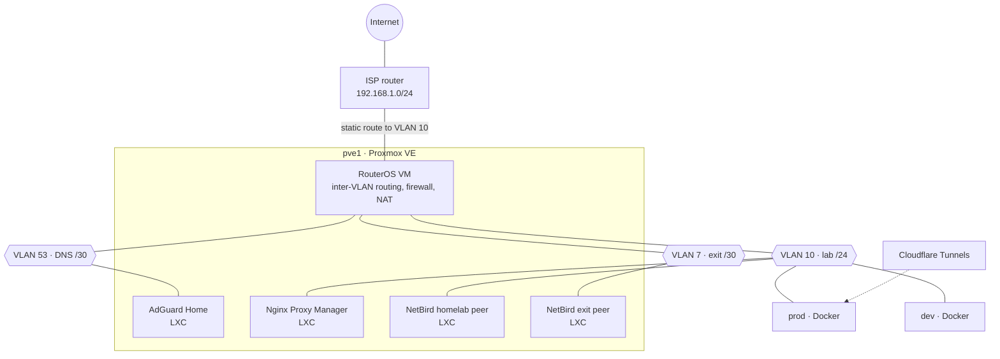

# Home-Lab

My self-hosted infrastructure: three machines at home running ~50 containers and LXCs, a virtual router, and a small identity platform tying it together. It's also where I learn networking, Linux, and operations by running things for real.

The idea behind it is **data sovereignty**: my photos, passwords, mail, documents, chat, and code live on hardware I own, in plain formats, behind a single sign-on I control.

---

## Hardware

| Host | Hardware | OS | Role |
|------|----------|----|------|
| `prod` | HP ProDesk | Debian 13 (Trixie) | Main Docker host: identity, mail, photos, docs, chat |
| `dev` | Lenovo ThinkCentre | Debian | Second Docker host: media, git, notes, monitoring |
| `pve1` | Dell Precision T1700, Xeon E3-1240 v3, 16 GB, Quadro K2000 | Proxmox VE | Hypervisor: router VM, DNS, reverse proxy, VPN peers |

I used to run two Proxmox nodes (`pve1` and `pve2`, the ThinkCentre) as a cluster, with `prod` acting as the corosync QDevice tiebreaker. In July 2026 I consolidated down to a single Proxmox host, the Xeon: I migrated every VM to `pve1`, tore corosync down by hand (the node had lost quorum, so `pvecm delnode` wouldn't work), and reinstalled the ThinkCentre as plain Debian (`dev`) so the container load could be split across two Docker hosts.

---

## Network



- **Segmented with VLANs.** A **MikroTik RouterOS** VM routes, firewalls, and NATs three 802.1Q VLANs:
  - **VLAN 10** (`/24`): the lab itself (servers, reverse proxy, my VPN peer). The ISP router has a static route back into it, so I can still reach it from the home LAN.
  - **VLAN 53** (`/30`): AdGuard Home alone, in a point-to-point subnet with the router.
  - **VLAN 7** (`/30`): the friends' exit peer alone, so their traffic only ever reaches the internet and never the lab.
- **Tagging on the hosts.** The physical switch is unmanaged, so each host tags its own frames (`vlan10@eno1` on Debian, a VLAN-aware `vmbr0` bridge with `vmbr0.10` on Proxmox).
- **DNS** is AdGuard Home (network-wide filtering and local records), isolated on its own VLAN.
- **NetBird** (WireGuard mesh) routing peers handle VPN access, with no open ports:
  - `NB-HL-RT-peer` routes **me** into the homelab and home network from anywhere.
  - `NB-RT-RU-peer` is an exit node for **friends in Russia**, giving them unfiltered internet access around local blocking. It sits on its own VLAN, so it can reach the internet but nothing else in my network.
- **Public exposure** is opt-in, per service, through **Cloudflare Tunnels** (used for Matrix federation and one hosted app). Everything else stays LAN/VPN-only.
- **TLS and routing** are handled by **Nginx Proxy Manager**. Every container joins one external Docker bridge, `ciugiulab_net`, so the proxy can reach each service by container name.

### Problems I hit (and fixed)

- **Asymmetric routing on dual-homed hosts.** At first the hosts had both a LAN IP and a VLAN IP. From the LAN, ping reached their VLAN address but SSH didn't. The SYN came in through RouterOS, but the SYN-ACK left directly through the LAN NIC, so RouterOS dropped the rest of the handshake as `connection-state=invalid`. The fix was to make every host VLAN-only and disable IPv6 on the parent NIC so router advertisements couldn't add a LAN path back.
- **Intel e1000e "Detected Hardware Unit Hang."** The onboard NIC on `pve1` would lock up until a reboot. Because the router VM lives on that host, the whole lab lost WAN each time. I found it in `journalctl -b -1` and worked around it by turning off TSO/GSO/GRO in a `post-up` hook.
- **Known weak point: the router is a VM.** RouterOS runs on `pve1`, so rebooting or losing that host takes down routing and WAN for every VLAN. It stays a single point of failure until I move RouterOS onto a dedicated physical router.
- **Lost config after updating an OCI-based LXC.** NPM kept its config on the container rootfs instead of a data volume, so updating the image wiped it. Since then, every service keeps its state on a dedicated data mount.

---

## Identity & SSO

**[Zitadel](https://zitadel.com)** (behind its own Traefik, backed by Postgres) is the central OpenID Connect provider. Eleven services log in through it instead of keeping their own user databases, each registered as its own Zitadel project:

| Service | Host | Notes |
|---------|------|-------|
| Proxmox VE | `pve1` | OpenID realm for the hypervisor web UI |
| Vaultwarden | `prod` | **SSO-only** (local login disabled) |
| Mail (Roundcube) | `prod` | **Custom-built image** (`roundcube-oidc` plugin + Dovecot master-user auth) |
| Immich | `prod` | Photo library login |
| Paperless-ngx | `prod` | OIDC via django-allauth |
| Matrix (Continuwuity) | `prod` | Extra trusted audiences for Zitadel's project-scoped tokens |
| Forgejo | `dev` | Git forge login |
| Cinema (Jellyfin) | `dev` | Media server login. The "Cinema" project will later cover the whole media stack |
| Kavita | `dev` | Reader login |
| Memos | `dev` | Notes login |
| TREK | `dev` | Trip planner login |

---

## Services

### `prod`: core services

| Service | What it does |
|---------|--------------|
| **Zitadel** + Traefik + Postgres | Identity provider / SSO for the whole lab |
| **Vaultwarden** | Bitwarden-compatible password manager |
| **Immich** (+ ML, Postgres/VectorChord, Valkey) | Photo and video backup with face/object recognition |
| **docker-mailserver** + **Roundcube** + Postgres | Full mail stack (Postfix, Dovecot) with SSO webmail |
| **Paperless-ngx** + Tika + Gotenberg + Postgres + Valkey | Document archive with OCR and Office/email parsing |
| **Matrix (Continuwuity)** + cloudflared | Federated chat homeserver on my own domain |
| **HP Scan-To** | Network scanner button straight into Paperless |
| **Nginx Proxy Manager** | Reverse proxy and Let's Encrypt certificates |
| **Homepage** | Service dashboard |
| **Speedtest Tracker** | Scheduled ISP bandwidth monitoring |
| **YTM-RC** | My own project: a YouTube Music remote control |

### `dev`: media, dev tools, monitoring

| Service | What it does |
|---------|--------------|
| **Forgejo** + Postgres | Self-hosted Git forge |
| **Jellyfin** | Media server |
| **Sonarr / Radarr / Prowlarr / Mylar3 / Bookshelf** | Library management and automation (see note below) |
| **qBittorrent** | Download client for the automation stack |
| **Kavita** | Ebook and comic reader |
| **Memos** | Quick notes |
| **CouchDB** | Sync backend for Obsidian LiveSync (my notes vault) |
| **TREK** | Trip planner |
| **Uptime Kuma** | Uptime and status monitoring for every service |
| **Socket Proxy** | Read-only, scoped Docker API instead of mounting the raw socket |

> **Why the media stack exists.** I got used to watching films and series for free on Russian streaming sites. Once I switched to watching in English, the only option left was paying for half a dozen subscriptions just to watch everything I wanted, and that's not something I'm willing to do. So I built my own library: the Arr stack finds and organises content, and Jellyfin serves it to every device at home.

### `pve1`: virtualisation

| Guest | Type | What it does |
|-------|------|--------------|
| **RouterOS** | VM | Inter-VLAN routing, firewall, and NAT for VLANs 10, 53, and 7 |
| **AdGuard Home** | LXC (Alpine) | DNS and ad/tracker filtering, on VLAN 53 (`/30`) |
| **Nginx Proxy Manager** | LXC | Edge reverse proxy |
| **NetBird: homelab peer** | LXC (Alpine, 64 MB) | My remote access to the lab and home network |
| **NetBird: exit peer** | LXC (Alpine, 64 MB) | Exit node so friends in Russia can get around internet blocks, on VLAN 7 (`/30`) |
| **Game servers** | VM | Spun up on demand for friends |

### Game servers

I also host game servers for my friends (Valheim, Palworld, and others), started on demand on `pve1` or one of the Docker hosts.

---

## Conventions

```
~/DockerVolumes/<Service>/        compose.yml, .env, configs
/mnt/data/docker/<Service>/       persistent data
```

- One Compose project per service. All volumes use absolute paths under `/mnt/data/docker/`.
- Everything joins the external `ciugiulab_net` bridge; nothing publishes a port unless it needs to.
- Secrets live in per-service `.env` files, never in the Compose files.
- Each host and service is documented in my self-hosted knowledge base (Obsidian vault), including a maintenance log of every change and incident.

---

## Roadmap

- [ ] Managed switch for real L2 isolation (VLAN tagging is currently logical only)
- [ ] Physical router to run RouterOS, removing `pve1` as a single point of failure for routing and WAN
- [ ] Put the rest of the media stack (Sonarr, Radarr, Prowlarr, Mylar3, Bookshelf, qBittorrent) behind Zitadel SSO
- [ ] Rebalance services between `prod` and `dev`
- [ ] Bring back centralised update automation (Watchtower) with notifications
- [ ] Publish sanitised Compose files for each service in this repo
- [ ] Versioned configs and automated off-host backups of `/mnt/data/docker`
